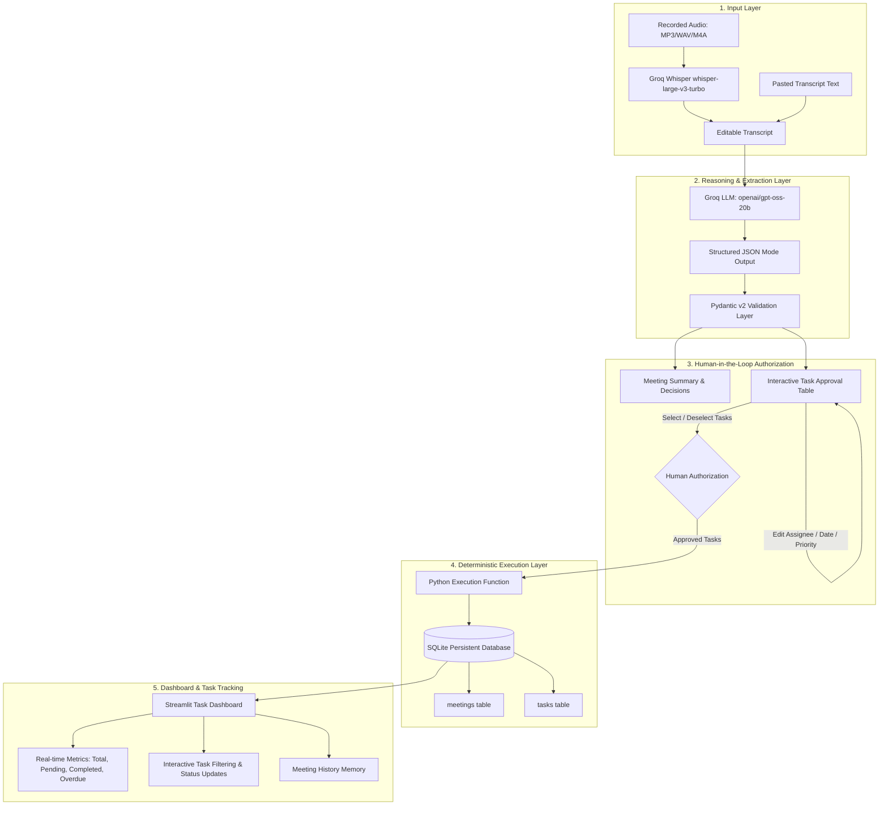

# MeetingOS — AI-Powered Meeting-to-Execution Agent

> **Tagline:** From Meeting Conversations to Actual Execution.  
> **Project Category:** Agentic AI / Productivity / Meeting Automation

MeetingOS is an end-to-end AI-powered meeting-to-execution system. Unlike conventional meeting assistants that only record or summarize discussions, MeetingOS extracts confirmed decisions and evidence-backed action items, subjects them to human review and approval, and executes approved tasks into persistent storage for real-time tracking.

---

## 1. System Architecture



### Why This Architecture?
1. **Deterministic Execution over Fragile Tool Calls:** Avoids fragile secondary LLM tool-calling loops that frequently trigger `400 Bad Request — tool_use_failed`. Python executes the exact authorized records.
2. **Human-in-the-Loop Safety:** The AI only *proposes* tasks; tasks are never committed without explicit user authorization.
3. **Data Integrity & Evidence:** Every extracted action item is linked to an exact quotation from the transcript.
4. **Lightweight & Free Tier Friendly:** Uses Groq's high-speed free tier (`whisper-large-v3-turbo` + `openai/gpt-oss-20b`) with local SQLite storage.

---

## 2. Project Directory Structure

```text
MeetingOS/
│
├── app.py                     # Streamlit frontend with 6 navigation views
├── requirements.txt           # Dependencies (Streamlit, Groq, Pydantic, Pandas, etc.)
├── .env                       # Environment variables (GROQ_API_KEY) - gitignored
├── .env.example               # Template for environment configuration
├── .gitignore                 # Excludes .venv, .env, and local database
├── README.md                  # Comprehensive documentation and demo guide
├── sample_transcript.txt      # Benchmark hackathon test scenario
│
├── services/
│   ├── __init__.py            # Services package initializer
│   ├── groq_service.py        # Groq client, audio transcription & meeting analysis
│   ├── agent.py               # Agentic orchestration & direct task execution
│   ├── database.py            # SQLite database initialization, queries, transactions
│   └── validation.py          # Pydantic models & overdue validation logic
│
└── data/
    └── meetingos.db           # SQLite database (auto-created on startup)
```

---

## 3. Technology Stack

| Component | Technology | Version / Model |
|---|---|---|
| **Programming Language** | Python | 3.11+ |
| **Frontend UI** | Streamlit | `>= 1.45.0` |
| **LLM Provider** | Groq API | Free Tier |
| **Meeting Analysis Model** | Groq | `openai/gpt-oss-20b` |
| **Audio Transcription** | Groq Whisper | `whisper-large-v3-turbo` |
| **Database** | SQLite3 | Built-in Python |
| **Data Validation** | Pydantic | `>= 2.0.0` |
| **Data Processing** | Pandas | `>= 2.2.0` |
| **Environment Config** | python-dotenv | `>= 1.0.1` |

---

## 4. Windows PowerShell Setup Guide

Follow these exact commands to set up the environment on Windows:

### Step 1: Open PowerShell in the Project Directory
```powershell
cd C:\Users\Akshaj\Documents\MeetingOS
```

### Step 2: Create a Virtual Environment
```powershell
python -m venv .venv
```

### Step 3: Activate the Virtual Environment
```powershell
.\.venv\Scripts\Activate.ps1
```
> *If PowerShell blocks script execution (`PSSecurityException`), run this once:*
> ```powershell
> Set-ExecutionPolicy -Scope Process -ExecutionPolicy Bypass
> .\.venv\Scripts\Activate.ps1
> ```

### Step 4: Upgrade Pip & Install Dependencies
```powershell
python -m pip install --upgrade pip
pip install -r requirements.txt
```

### Step 5: Configure the Groq API Key
Copy `.env.example` to `.env` if not already present:
```powershell
Copy-Item .env.example .env
```
Open `.env` in VS Code or Notepad and paste your Groq API key:
```ini
GROQ_API_KEY="gsk_your_groq_api_key_here"
```
*(Get a free key from [console.groq.com/keys](https://console.groq.com/keys)).*

---

## 5. Running the Application

Launch MeetingOS with:
```powershell
streamlit run app.py
```

### Terminal Output
You should see:
```text
  You can now view your Streamlit app in your browser.

  Local URL: http://localhost:8501
  Network URL: http://192.168.x.x:8501
```
Open `http://localhost:8501` in your browser.

- To stop the application: Press `Ctrl + C` in PowerShell.
- To restart: Re-run `streamlit run app.py`.

---

## 6. Testing & Hackathon Demo Walkthrough

### The Benchmark Scenario
MeetingOS includes a built-in benchmark scenario (`sample_transcript.txt`):
- **Title:** College Event Management Platform
- **Date:** October 31, 2026
- **Participants:** Rahul, Meera, Ananya, Arjun

### Step-by-Step Demo Guide:
1. Navigate to **➕ New Meeting** in the sidebar.
2. Click the **"📋 Load Sample Hackathon Benchmark Scenario"** button. This automatically loads the 4 participants and the complete transcript.
3. Click **"🧠 Analyse Meeting with AI"**.
4. MeetingOS processes the transcript and redirects to **🔍 Review AI Findings**:
   - **Summary:** Concise synthesis of the meeting.
   - **Decisions:** 
     1. Postpone email notifications to future enhancement.
     2. Next review meeting scheduled for November 6 at 4 PM.
   - **Extracted Action Items (9 Tasks):**
     1. *Complete login testing* (Meera, 2026-11-03)
     2. *Validate registration form email handling* (Meera)
     3. *Complete database integration* (Arjun, 2026-11-05)
     4. *Test duplicate registration prevention* (Arjun)
     5. *Finish event registration API* (Ananya, 2026-11-04)
     6. *Document API endpoints* (Ananya)
     7. *Deploy application* (Rahul, 2026-11-06)
     8. *Prepare technical architecture diagram* (Ananya)
     9. *Prepare presentation slides* (Meera, 2026-11-05)
5. Notice that email notifications were **not** fabricated as an active task.
6. Check or uncheck individual tasks, or use **Select All** / **Deselect All**.
7. Click **"🚀 Authorize & Execute Approved Tasks"**.
8. Navigate to **📊 Dashboard** to view live metrics, filters, and status updating.
9. Navigate to **📜 Meeting History** to view past meetings and linked tasks.

---

## 7. Validation Checklist

| Test Scenario | Expected Outcome | Status |
|---|---|:---:|
| **Valid Transcript** | Structured summary, decisions, and tasks extracted | ✅ PASS |
| **Audio File Upload** | Groq Whisper transcribes into editable text area | ✅ PASS |
| **Review Before Analysis** | User can edit transcript before triggering analysis | ✅ PASS |
| **Empty / Short Transcript** | Graceful validation error raised (<30 chars) | ✅ PASS |
| **Unstated Assignee/Deadline** | Explicit `null` / `None` returned, never invented | ✅ PASS |
| **Deferral Decision vs Task** | "Future enhancement" logged as decision, not task | ✅ PASS |
| **Human-in-the-Loop** | No task saved until explicit execution button click | ✅ PASS |
| **Duplicate Prevention** | Re-clicking execute ignores duplicate items | ✅ PASS |
| **Overdue Detection** | Past due dates flagged as overdue on dashboard | ✅ PASS |
| **Status Updates** | Pending → In Progress → Completed reflected immediately | ✅ PASS |
| **Persistence Across Restarts** | Saved tasks and meetings remain intact in SQLite | ✅ PASS |

---

## 8. Troubleshooting

- **PowerShell ExecutionPolicy Error:** Run `Set-ExecutionPolicy -Scope Process -ExecutionPolicy Bypass` before activating `.venv`.
- **Groq Rate Limit (HTTP 429):** The free tier has TPM/RPM limits. Wait 10-15 seconds and re-analyze.
- **Audio file larger than 25 MB:** Groq's free endpoint has a 25 MB file limit. Compress to MP3 or test with shorter recordings.
# MeetingOS

